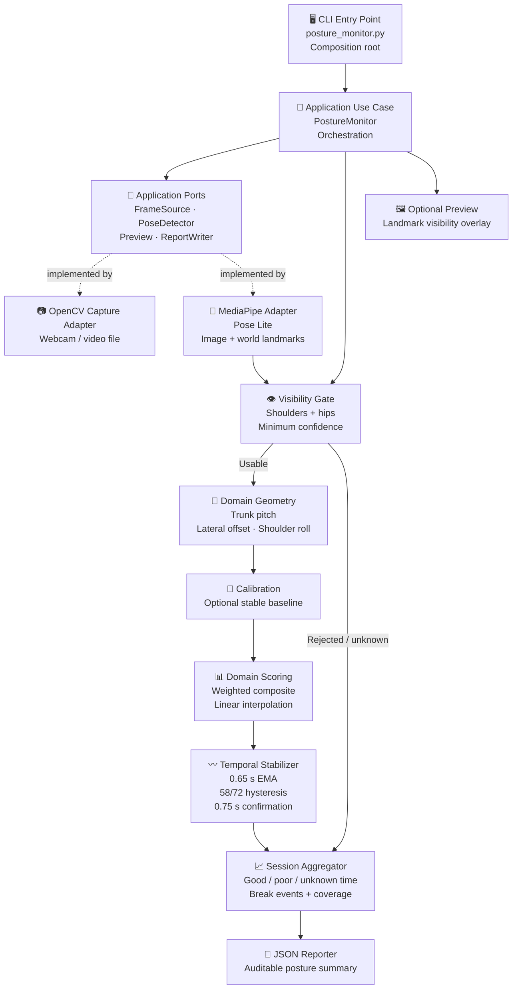
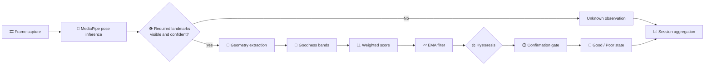

# 🪑 Seated Posture Monitor

    

**Real-time seated upper-body posture tracking from a webcam or video file — with trunk pitch, lateral offset, shoulder roll scoring, EMA stabilization, and an auditable JSON session summary.**

> ⚠️ Engineering demonstration only. This project is not a medical or ergonomic diagnosis tool.

## 🎬 45-second project walkthrough

Click the preview below to open the 45-second MP4 walkthrough.

[](docs/assets/posture-monitor-demo-45s.mp4)

**[▶ Watch / open the 45-second demo video](docs/assets/posture-monitor-demo-45s.mp4)** · [Subtitles](docs/assets/posture-monitor-demo.srt)

> **Demo disclosure:** This is a simulated product walkthrough with an illustrative interface and synthetic metrics. It is not a recording of a real webcam session, a live MediaPipe inference run, or evidence of validated posture-detection accuracy. Real-device validation must be demonstrated separately using a genuine 30–60-second session recording.

---

## 🌐 Platform Overview

| Capability | Description |
| --- | --- |
| **Landmark Detection** | MediaPipe Pose Landmarker Lite — image and world landmarks, CPU-only |
| **Geometry Metrics** | Trunk pitch · torso-normalized lateral offset · shoulder roll |
| **Scoring** | Weighted composite: 65% trunk pitch · 20% lateral offset · 15% shoulder roll |
| **Temporal Stabilization** | 0.65 s EMA + 58/72 hysteresis + 0.75 s confirmation — suppresses frame flicker |
| **Visibility Gating** | Both shoulders + both hips must meet the configured visibility/presence threshold (default 0.55); otherwise the sample is **unknown** |
| **Calibration** | Optional 5-second personal baseline (`--calibrate`); calibration time is excluded from session scoring |
| **Camera Diagnostic** | Separates image-quality warnings, MediaPipe detections, and geometry rejection reasons |
| **Session Output** | Auditable JSON summary with unknown time counted against full session duration |

---

## 🏗️ Architecture



The domain layer contains posture rules and calculations; it does not depend on OpenCV or MediaPipe. Infrastructure adapters implement application-facing ports, while the CLI acts as the composition root.

---

## 🔄 Per-Frame Decision Flow



---

## 📐 Scoring Thresholds

| Metric | Weight | Good Band | Poor Band |
| --- | ---: | ---: | ---: |
| **Trunk Pitch** | 65% | ≤ 10° | ≥ 25° |
| **Lateral Offset** | 20% | ≤ 0.05 ratio | ≥ 0.18 ratio |
| **Shoulder Roll** | 15% | ≤ 5° | ≥ 18° |

Scores interpolate linearly between each metric's good and poor bands, then combine into a weighted composite.

> These values are transparent engineering heuristics and have not been clinically validated. They should be evaluated against labelled recordings before being treated as general ergonomic thresholds.

---

## 🚀 Quick Start (Windows PowerShell)

```powershell
# 1. Create and activate a virtual environment
py -3.11 -m venv .venv
.\.venv\Scripts\Activate.ps1
python -m pip install --upgrade pip
python -m pip install -r requirements-dev.txt

# 2. Run from webcam (45-second session)
python posture_monitor.py --source 0 --duration 45 --out posture.json

# 3. Run from a video file
python posture_monitor.py --source "C:\Videos\video.mp4" --duration 60 --out posture.json

# 4. Enable the optional live preview
python posture_monitor.py --source 0 --duration 45 --out posture.json --preview

# 5. Use an optional personal calibration baseline
python posture_monitor.py --source 0 --duration 45 --out posture.json --calibrate

# 6. Verify MediaPipe model loading and CPU inference
python scripts/smoke_test_mediapipe.py
```

The official MediaPipe Lite model is downloaded once to the user's local model cache on first use. An internet connection is needed for the initial download unless a local model path is supplied with `--model`.

---

## 🔬 Camera Diagnostic

```powershell
python posture_monitor.py --source 0 --diagnose-camera --preview `
  --diagnostic-seconds 10 --width 1280 --height 720
```

The diagnostic report separates three categories:

| Category | What It Checks |
| --- | --- |
| **Image Quality** | Resolution · brightness · contrast · possible blur |
| **MediaPipe Detections** | Pose detection and model confidence thresholds |
| **Geometry Rejections** | Reasons why detected landmarks were marked unusable |

Requested camera resolution may be ignored by the camera driver — inspect the actual dimensions in the diagnostic report. Image-quality thresholds are advisory and **never** determine posture classification. Do not lower confidence thresholds merely to obtain a successful run; doing so can increase false detections.

The `--camera-view` argument records the user-declared camera angle in session metadata. It does not rotate the image or change the geometry algorithm.

---

## 🧪 Tests & Validation

```powershell
# Run the automated test suite (synthetic landmarks + fake adapters)
python -m pytest -q

# Compile check
python -m compileall -q posture_monitor.py src tests scripts
```

Automated tests validate software behavior against synthetic data; they do not establish real-world posture accuracy. Before submission, record **30–60 seconds** with an upright phase followed by a slouched phase and replace the illustrative `posture.json` with genuine output.

---

## 🏛️ Clean Architecture & SOLID

| Layer | Responsibility |
| --- | --- |
| **CLI / Composition Root** | Parses arguments and wires dependencies |
| **Application Use Cases / Ports** | Orchestrates capture → inference → geometry → scoring → reporting through abstractions |
| **Domain Rules** | Visibility gating · thresholds · weighted scoring · calibration · EMA + hysteresis · session aggregation |
| **OpenCV Adapter** | Implements frame capture for webcam and video file sources |
| **MediaPipe Adapter** | Implements pose inference and returns image/world landmarks |
| **JSON / Preview Adapters** | Persist session reports and optionally render diagnostic overlays |

The design applies Single Responsibility, Open/Closed, Liskov Substitution, Interface Segregation and Dependency Inversion through small ports and replaceable adapters. The domain layer remains independent of computer-vision libraries.

---

## ⚠️ Known Limitations

| Area | Limitation |
| --- | --- |
| **People** | Single-person only — multiple people in frame are not handled |
| **Body Coverage** | Current geometry requires both shoulders and both hips to be visible and sufficiently confident |
| **Lower Body** | No lower-body posture, chair or desk ergonomics |
| **Camera** | Camera should remain fixed during the session; angle, lighting, focus and framing affect landmark quality |
| **Medical** | Not a medical device and does not diagnose conditions or provide clinical posture assessment |
| **Calibration** | Personal baseline is relative to the posture held during calibration — not proof of ideal posture |
| **Resolution** | Requested camera resolution may be overridden by the camera driver |
| **Validation** | Synthetic tests and the simulated demo do not replace real webcam/video validation |

---

## 📄 Session JSON Output

The repository includes an illustrative `posture.json` to show the report structure. It is explicitly marked as synthetic and must be replaced with a real recording before submission. A real report includes session timing, posture durations, unknown-time coverage, break events, feature statistics, processing counters and decision configuration.

Example excerpt:

```json
{
  "schema_version": "1.2",
  "sample_only": true,
  "submission_ready": false,
  "note": "Illustrative output only. Replace this file with a real 30-60 second webcam/video run before submission.",
  "application": {
    "name": "seated-posture-monitor",
    "version": "1.2.5"
  },
  "metrics": {
    "session_duration_s": 30.0,
    "good_posture_duration_s": 13.8,
    "bad_posture_duration_s": 13.2,
    "unclassified_duration_s": 3.0,
    "good_posture_pct": 46.0,
    "stable_observation_coverage_pct": 90.0,
    "posture_score_0_100": 46.0,
    "posture_break_count": 1
  }
}
```

Unknown time is counted against the full session duration — it is not treated as good posture. The example numbers above are synthetic, not measured results.

---

**Built by [Alen Thomas](https://github.com/AIstar007) · Engineering Demonstration · v1.2.5**

[](https://github.com/AIstar007) [](https://linkedin.com/in/alen-thomas-3558bb187/) [](https://portfolio-website-alpha-nine-69.vercel.app/)
