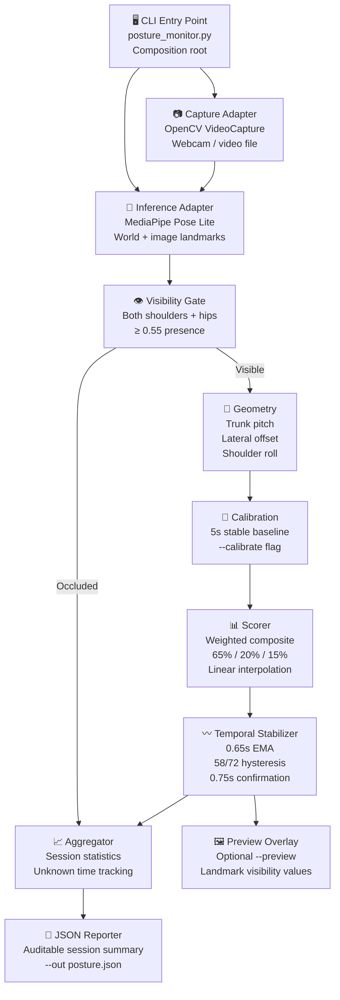
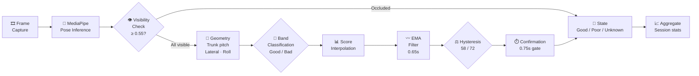

Markdown · posture-monitor-readme.md

# 🪑 Seated Posture Monitor

    

**Real-time seated upper-body posture tracking from a webcam or video file — with trunk pitch, lateral offset, shoulder roll scoring, EMA stabilization, and an auditable JSON session summary.**

> ⚠️ Engineering demonstration only. Not a medical or ergonomic diagnosis tool.

---

## 🌐 Platform Overview

| Capability | Description |
| --- | --- |
| **Landmark Detection** | MediaPipe Pose Lite — scale-independent world landmarks, CPU-only |
| **Geometry Metrics** | Trunk pitch · torso-normalized lateral offset · shoulder roll |
| **Scoring** | Weighted composite: 65% trunk pitch · 20% lateral offset · 15% shoulder roll |
| **Temporal Stabilization** | 0.65 s EMA + 58/72 hysteresis + 0.75 s confirmation — suppresses frame flicker |
| **Visibility Gating** | Both shoulders + both hips must have visibility/presence ≥ 0.55; otherwise sample is **unknown** |
| **Calibration** | Optional 5-second personal baseline (`--calibrate`); excluded from session scoring |
| **Camera Diagnostic** | Separates image-quality warnings, MediaPipe detections, and geometry rejection reasons |
| **Session Output** | Auditable JSON summary with unknown time counted against full session duration |

---

## 🏗️ Architecture



---

## 🔄 Per-Frame Decision Flow



---

## 📐 Scoring Thresholds

| Metric | Weight | Good Band | Bad Band |
| --- | --- | --- | --- |
| **Trunk Pitch** | 65% | ≤ 10° | ≥ 25° |
| **Lateral Offset** | 20% | ≤ 0.05 ratio | ≥ 0.18 ratio |
| **Shoulder Roll** | 15% | ≤ 5° | ≥ 18° |

> Scores interpolate linearly between bands and combine into a weighted composite. These are transparent engineering heuristics — not clinically validated thresholds.

---

## 🚀 Quick Start (Windows PowerShell)

```powershell
# 1. Create virtual environment
py -3.11 -m venv .venv
.\.venv\Scripts\Activate.ps1
python -m pip install --upgrade pip
python -m pip install -r requirements-dev.txt

# 2. Run from webcam (45-second session)
python posture_monitor.py --source 0 --duration 45 --out posture.json

# 3. Run from video file
python posture_monitor.py --source path\to\video.mp4 --duration 60 --out posture.json

# 4. Enable live preview overlay
python posture_monitor.py --source 0 --duration 45 --out posture.json --preview

# 5. Run with personal calibration baseline
python posture_monitor.py --source 0 --duration 45 --out posture.json --calibrate

# 6. Verify MediaPipe model loading + CPU inference
python scripts/smoke_test_mediapipe.py
```

> The official MediaPipe Lite model is downloaded once to the user's cache on first use.

---

## 🔬 Camera Diagnostic

```powershell
python posture_monitor.py --source 0 --diagnose-camera --preview \
  --diagnostic-seconds 10 --width 1280 --height 720
```

The diagnostic report separates three categories:

| Category | What It Checks |
| --- | --- |
| **Image Quality** | Resolution · brightness · contrast · possible blur |
| **MediaPipe Detections** | Pose detection, presence and tracking (default threshold: 0.5) |
| **Geometry Rejections** | Reasons why samples were marked unknown |

> Requested camera resolution may be ignored by the driver — inspect actual dimensions in the report. Image-quality thresholds are advisory and **never** determine posture classification. Do not lower detection thresholds just to get a successful run; it increases false detections.

---

## 🧪 Tests & Validation

```powershell
# Run test suite (synthetic landmarks + fake adapters)
python -m pytest -q

# Compile check
python -m compileall -q posture_monitor.py src tests scripts
```

Tests validate software behavior against synthetic data — not real-world posture accuracy. Before submission, record **30–60 seconds** with an upright phase followed by a slouched phase and replace the illustrative `posture.json` with genuine output.

---

## 🏛️ Clean Architecture

| Layer | Responsibility |
| --- | --- |
| **CLI / Composition Root** | Wires all dependencies; entry point |
| **Application Use Cases / Ports** | Orchestrates capture → inference → geometry → scoring → reporting |
| **Domain Rules** | Visibility gating · band thresholds · weighted scoring · EMA + hysteresis |
| **OpenCV Adapter** | Implements capture port — webcam and video file |
| **MediaPipe Adapter** | Implements inference port — world + image landmarks |

---

## ⚠️ Known Limitations

| Area | Limitation |
| --- | --- |
| **People** | Single-person only — multiple people in frame not handled |
| **Body coverage** | Requires both shoulders and both hips to be visible and in frame |
| **Lower body** | No lower-body posture, chair or desk ergonomics |
| **Camera** | Camera must remain fixed during the session |
| **Medical** | Does not handle medical conditions or clinical posture assessment |
| **Calibration** | Personal baseline is relative to posture held during calibration — not proof of ideal posture |
| **Resolution** | Requested resolution may be overridden by the camera driver |

---

## 📄 Session JSON Output

```json
{
  "version": "1.2.5",
  "duration_seconds": 45,
  "good_posture_seconds": 31.2,
  "poor_posture_seconds": 8.4,
  "unknown_seconds": 5.4,
  "session_score": 0.74,
  "metrics": {
    "trunk_pitch_mean_deg": 8.3,
    "lateral_offset_mean": 0.04,
    "shoulder_roll_mean_deg": 3.1
  }
}
```

> Unknown time is counted against the full session duration — not treated as good posture.

---

**Built by [Alen Thomas](https://github.com/AIstar007) · Engineering Demonstration · v1.2.5**

[](https://github.com/AIstar007) [](https://linkedin.com/in/alen-thomas-3558bb187/) [](https://portfolio-website-alpha-nine-69.vercel.app/)